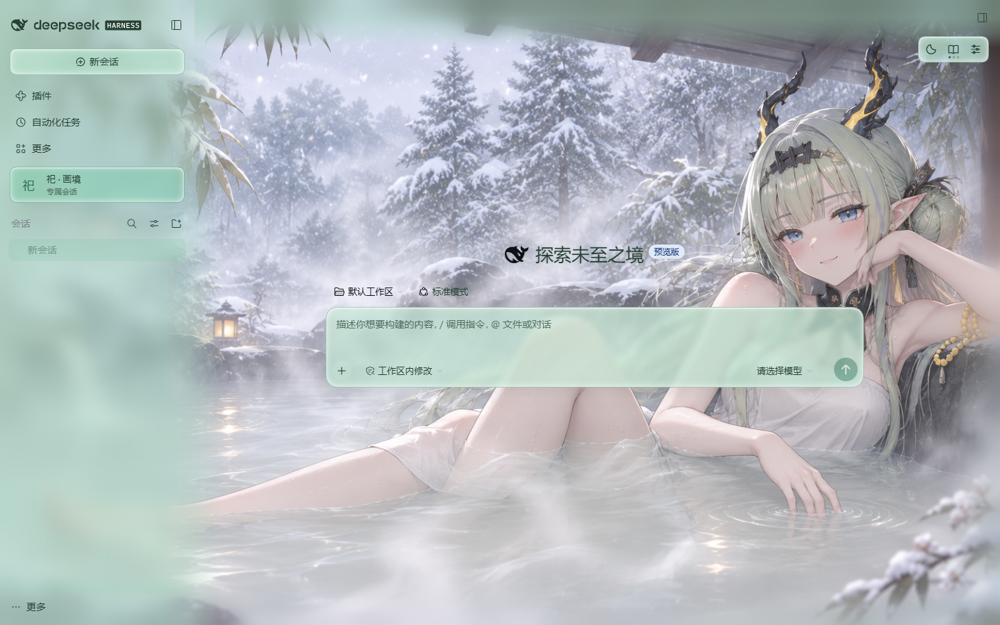

# 祀 · 雨荷青玉

为 DeepSeek Harness 带来雨荷、青玉与水墨意境的角色主题皮肤。

以《明日方舟：终末地》角色「祀」为主题，将七组场景、动态壁纸与柔和玻璃材质融入聊天界面，在日常阅读、专注工作与纯画面观赏之间切换。

**维护预览：[下载 0.3.0-beta.1](https://github.com/KshineKX/si-rain-jade/releases/download/v0.3.0-beta.1/Si-Rain-Jade-0.3.0-beta.1.zip)** · [Beta 更新说明](https://github.com/KshineKX/si-rain-jade/releases/tag/v0.3.0-beta.1)

本轮主要调整宽屏阅读、主题挂载与资源加载，适合愿意试用维护版的用户。日常使用可继续选择下方稳定版。

**[下载 0.2.0](https://github.com/KshineKX/si-rain-jade/releases/download/v0.2.0/Si-Rain-Jade-0.2.0.zip)** · [更新说明与文件校验](https://github.com/KshineKX/si-rain-jade/releases/tag/v0.2.0) · [历史版本](https://github.com/KshineKX/si-rain-jade/releases)

## 预览

[观看宣传视频](https://www.bilibili.com/video/BV1ZRWA6vEP3/)

### 聊天界面

柔和的侧栏、输入框与三键工具栏，配合背景和深浅配色。

### 窗榻听雨

### 雪庭温泉

## 功能

- **宽屏阅读**：阅读衬底跟随 DSH 原生正文宽度，调整窗口或侧栏时自动定位。
- **主题适配**：使用宿主插件接口管理视觉挂载和主题层，减少流式内容更新时的重复扫描。
- **按需播放**：专注、静态和减少动态效果等条件下，不主动为新场景加载视频。
- **开屏动画**：进入画境前呈现水墨开场，支持关闭、重播、跳过与 Esc；根据当前壁纸和外观自然收尾。
- **七组场景**：雨声里的片刻、窗榻听雨、铺卷小憩、墨境桥行、掌柜闲时、祀的鬼画符、雪庭温泉。
- **三档显示**：默认保留日常聊天；专注加强阅读衬底并暂停动态；观赏隐藏界面，展示纯画面。
- **阅读浓度调节**：在设置中调整 0–100% 雾层浓度，默认与专注模式分别记忆偏好。
- **动态壁纸**：荷塘、窗榻、小憩支持循环动态；温泉包含开场动作与持续微动态。提供标准与极清增强两档画质。
- **外观搭配**：深浅配色、多种材质与独立场景选择，切换显示模式时保持背景位置。
- **固定会话入口**：为已有会话提供左栏快捷入口，列表视图也可使用。

桥行、掌柜与茶间场景为静态。温泉使用同一组雪日素材，深浅切换改变界面配色。[查看场景与使用说明](docs/USAGE.md)

## 安装

**环境要求：Windows、DeepSeek Harness、Node.js 22.19+ 或 24+。** 当前推荐搭配 DSH 0.2.2-rc.1；其他版本请先查看[兼容说明](docs/COMPATIBILITY.md)。

1. 下载上方完整安装包并解压。GitHub 自动生成的 Source code ZIP 不包含完整壁纸资源。
2. 确认终端中运行 `node --version` 能显示版本号。
3. 保存工作，完全退出 DSH，包括托盘进程。
4. 双击 `Install.cmd`，安装成功后启动 DSH。

已安装用户按相同步骤升级。安装器会保留原版本和配置备份；如果提示配置或链接冲突，请先处理提示，不要手动覆盖。

首次安装会切换皮肤，并停用检测到的其他皮肤条目；执行前可查看[安装改动范围](docs/USAGE.md#安装改动范围)。已有受控升级保留原 patch。

使用自定义 DSH 数据目录或非默认 profile 时，请按[高级安装说明](docs/USAGE.md#自定义数据目录)指定目标。

### 回退与卸载

退出 DSH 后运行 `Rollback.cmd`，可回到此次升级前的皮肤版本。使用 `Uninstall.cmd` 卸载；如果当前处于升级状态，先按提示回退，再执行卸载。

## 操作

| 控件 | 用法 |
|---|---|
| 深浅键 | 切换浅色与深色外观 |
| 书页键 | 默认 → 专注 → 观赏 → 默认 |
| 设置键 | 选择场景、材质、配色、画质与阅读浓度 |
| Esc | 优先关闭设置面板；观赏状态下返回默认 |

观赏时，工具栏在鼠标静止后自动淡出；移动鼠标或按 Tab 唤回。切换显示模式会保留未发送的草稿与滚动位置。

## 开屏

设置 → 开屏可关闭或重播。荷塘浅色、非默认材质使用约 14.6 秒的专属结尾；其他场景、深色或默认材质使用约 9.6 秒的剪影过渡，渐散后显露当前背景。开屏不会更改壁纸选择，跳过或结束后恢复聊天与焦点。

开屏片段来源：[见习饼饼（UID736251）· BV15eJD6DEec](https://www.bilibili.com/video/BV15eJD6DEec/)，非商用署名使用；作者署名在播放时显示。[开屏使用与素材说明](packages/skin/docs/OPENING.md)

## 许可与致谢

本项目为非官方同人作品。代码采用 [MIT License](LICENSE)；角色、美术、开屏片段与商标权利独立于代码许可。上游项目及许可见 [NOTICE](NOTICE.md) 和[来源说明](packages/skin/docs/PROVENANCE.md)。

截图中的额度挂件由独立插件 [DeepSeek Balance Whale Widget](https://github.com/MeteorNOX/DeepSeek-Balance-Whale-Widget) 提供，需另行安装。包内附[小祀透明头像和导入说明](extras/quota-widget/README.md)，也可[单独下载 PNG](https://github.com/KshineKX/si-rain-jade/releases/download/v0.3.0-beta.1/si-avatar.png)，在挂件的角色图库中选用；不会自动修改账户或图库，泡泡图库为另一项功能。

